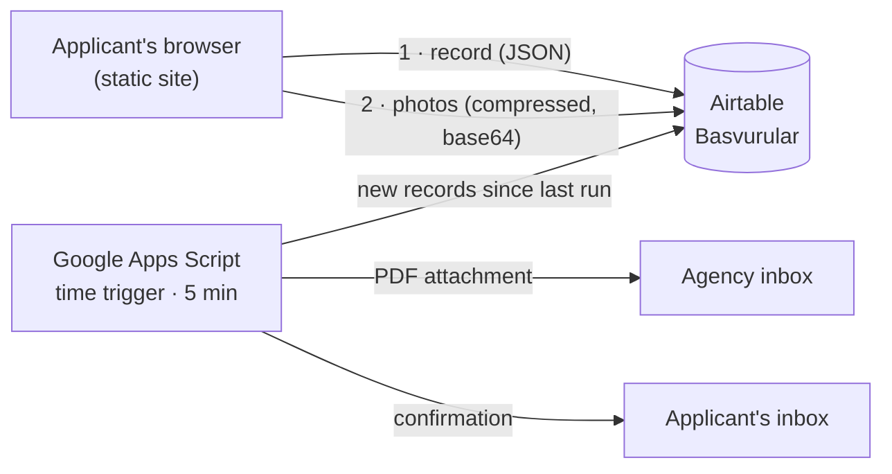

# Diyarbakır Sinema Ofisi — Film Office Website & Casting Platform

A website and an actor/cast registration system for **Diyarbakır Sinema Ofisi** (Diyarbakır Film Office), an organisation that has supported film, TV, documentary and commercial productions in south-eastern Turkey since 2017.

It is a static site with no framework and no paid backend. Applicants fill in an 8-step form. Their data and photos go to Airtable, and a scheduled Google Apps Script emails the agency a print-ready PDF of every application.

> **Live site:** _coming soon_ · **Status:** client project, ready for launch
> The site is in Turkish; the code comments are in Turkish as well.


---

## Highlights

| | |
|---|---|
|  |  |
| **8-step registration form**: progress sidebar, conditional steps, inline validation | **Project archive**: 12 films with festival and award history in an accessible dialog |
|  |  |
| **Responsive**: phone and tablet layouts, mobile menu, touch-friendly controls | **Automatic PDF**: every application arrives as a printable A4 sheet by email (sample data) |


---

## The brief

The office collected casting applications through Google Forms. Three things were wrong with it:

- it sent applicants away from the website,
- it couldn't take photo uploads in a usable way,
- it left the agency with a spreadsheet instead of something they could print and file.

The client wanted three things:

1. a site that presents the office and its film work with a strong cinematic identity;
2. a registration form that stays on the site, accepts photos and works well on phones;
3. each application delivered as a **printable document**, with no manual copying.

## My role

I handled design and development end to end, from the first layout to a launch-ready site:

- visual identity on the web: type, colour, motion,
- front-end development,
- the data model in Airtable,
- the PDF and email automation,
- SEO,
- security hardening.

---

## Features

**Website**
- Cinematic visual language:
  - condensed display type paired with a typewriter label font,
  - a "projector light" background,
  - a looping strip of film posters above the footer.
- Project archive. Each film opens a native `<dialog>` that splits awards from festival selections automatically.
- Photo gallery with a lightbox: keyboard arrows, swipe on touch screens, focus handling.
- Accessible by default:
  - semantic landmarks and real buttons,
  - `prefers-reduced-motion` is respected,
  - visible focus states,
  - meaningful images have alt text; decorative ones are hidden from screen readers.

**Registration form**
- 8 steps rendered from a single schema (`SECTIONS` in `script.js`), with step-level validation and a review/summary step.
- Conditional logic:
  - the guardian step appears only for applicants under 18,
  - the photo uploads appear only for applicants who already have their own material.
- Input helpers:
  - Turkish phone formatting that keeps the cursor in place (`0532 123 45 67`),
  - an email field split into a local part and a domain picker,
  - drag-and-drop photo upload with a preview.
- **Photos are compressed in the browser before upload.** An 11.5 MB phone photo becomes a 502 KB, 1600 px JPEG in about 0.2 s.

**Back office**
- Records are written to Airtable, and attachments go through Airtable's upload API.
- A Google Apps Script runs every 5 minutes. It turns each new record into a branded, one-page A4 **PDF**, emails it to the agency and sends the applicant a confirmation.

**SEO**
- Descriptive title and meta description, plus Open Graph and Twitter cards with a custom 1200×630 share image.
- **schema.org** graph: the `Organization` plus 12 `Movie` entries with directors, durations and awards.
- Award lists live in the HTML rather than only in JavaScript, so search engines can index them.
- `robots.txt` and a branded `404.html`.

---

## Architecture



- **No server of its own.** The site is plain HTML, CSS and JavaScript, so any static host works.
- **Airtable** is the database the office actually works in day to day.
- **Apps Script** runs under the office's own Google account: no third-party automation service, no monthly operation limits.
- **Planned before public launch:** a Cloudflare Worker between the form and Airtable (see Roadmap).

## Tech stack

`HTML5` · `CSS3` (custom properties, grid, animations) · `Vanilla JavaScript (ES2020)` · `Airtable REST & Content API` · `Google Apps Script` · `schema.org JSON-LD` · `Git`

---

## Problems I solved

**1. Keeping a secret on a site with no server**
The form has to call Airtable from the browser, and anything shipped to a browser is public. I took four steps:

1. I scoped the token to **write-only on one base**. I tested it: it can create records but gets `403` on reads, so applicant data can't be pulled out.
2. I moved the token into a git-ignored `config.js`, with `config.example.js` as a template.
3. I scanned the full git history to confirm no token was ever pushed.
4. The PDF script uses a separate **read-only** token that never leaves Google.

The remaining risk is someone abusing the write token. A server-side proxy will close that (Roadmap).

**2. Spam protection without a backend**
Three layers that cost nothing to run:

- a hidden honeypot field; bots that fill it are shown a fake success message,
- a minimum fill time, measured from the first interaction rather than page load,
- a per-device limit on repeat submissions, stored in `localStorage` and guarded with try/catch.

I tested each case against a stubbed `fetch`, so the tests wrote no records.

**3. Staying inside free-tier storage**
Airtable's free plan has 1 GB of attachments, and raw phone photos would fill that in roughly 150 applications. Compressing in the browser with `createImageBitmap` and a canvas cuts each photo by about 95%. If the browser can't decode a file (some HEIC images), the original is sent, but only after a size check. That check runs **before** the record is created, so a failed photo never leaves a half-saved application.

**4. A long form that doesn't feel long**
Every field is defined in one schema: label/column name, type, required, `showIf`, `minor`, `half`. The same schema drives rendering, validation, conditional visibility, the summary step and the Airtable payload. Step 6 is skipped automatically for adults, and a vertical step list shows where the applicant is and what's left.

**5. A PDF people can actually print**
Apps Script converts HTML to PDF with a limited rendering engine, so the layout uses tables rather than flexbox and fits on one A4 page.

Two details needed extra care:

- **Turkish capitals.** CSS `text-transform: uppercase` turns Turkish `i` into `I` instead of `İ`. Headings are therefore uppercased with a small locale-aware function.
- **Photos.** Portrait, face and body photos are embedded from Airtable's thumbnails, which also converts HEIC files to JPEG.

**6. Keeping form and database in sync**
Column names in Airtable must match the form exactly, down to the punctuation. I wrote small scripts that compare the form schema with the live table schema. They caught a column that was missing, link columns that had the wrong type, and a filter formula that used a function name Airtable doesn't support (`DATETIME_ADD` instead of `DATEADD`).

---

## Project structure

```
├── index.html               # single-page site: hero, form, about, services, projects, gallery
├── style.css                # design tokens, components, responsive rules
├── script.js                # menu, dialogs, gallery, registration form & Airtable client
├── config.example.js        # template for config.js (Airtable IDs + write-only token)
├── apps-script/
│   └── basvuru-pdf.example.gs   # Google Apps Script: Airtable → PDF → email (token removed)
├── 404.html · robots.txt · og.jpg
├── logo/ · movie-img/ · galeri/ · img/hero.jpg
└── docs/screenshots/        # images used in this README
```

## Running locally

```bash
git clone https://github.com/Ramo212121/diyarbakir-sinema-ofisi.git
cd diyarbakir-sinema-ofisi
cp config.example.js config.js     # add your own Airtable base, table and write-only token
python3 -m http.server 8000        # open http://localhost:8000
```

The site also works when you open `index.html` directly in a browser. To set up the PDF emails, paste `apps-script/basvuru-pdf.example.gs` into a new project at [script.google.com](https://script.google.com), add a read-only token, then run `kurulum` once.

## Roadmap

- [ ] **Cloudflare Worker proxy and Turnstile.** The Airtable token moves to the server, every submission is verified, and requests are rate-limited per IP.
- [ ] **Privacy notice (KVKK, Turkey's data protection law)** and the consent checkboxes that go with it. The client's lawyer is preparing them.
- [ ] Self-hosted fonts, so no visitor data goes to third parties.
- [ ] Canonical URL, sitemap and absolute Open Graph URLs once the domain is live.

---

Built by **Ramazan Karahan** · [GitHub](https://github.com/Ramo212121)

The code is shared as a portfolio piece. The logo, photographs, film posters and texts belong to Diyarbakır Sinema Ofisi and may not be reused.
